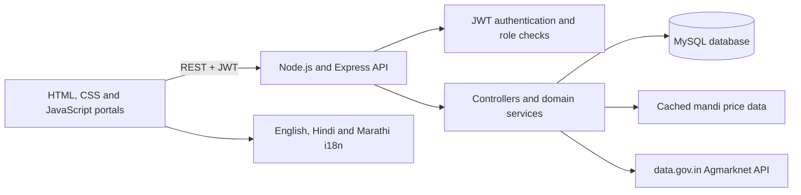

<div align="center">

# KhetSetu

**Market intelligence and digital trade workflows for India's agricultural community.**

KhetSetu helps farmers compare mandi prices after estimated transport costs, publish produce lots, connect with buyers, and manage the steps from negotiation through delivery. Separate portals support buyers, Farmer Producer Organizations (FPOs), transporters, and administrators.

[](https://nodejs.org/)
[](https://expressjs.com/)
[](https://www.mysql.com/)
[](#multilingual-support)

</div>

---

## What the project does

Agricultural sellers often have to make decisions with incomplete information: which market offers the best return after freight, which buyers need their crop, and whether storage costs are justified by a possible later sale. KhetSetu brings these workflows into one web platform.

A farmer can review market prices, compare estimated net realization across mandis, create a graded crop lot, respond to buyer offers, follow an order, request storage, or raise a dispute. Buyers can search available lots and negotiate. FPOs can coordinate member supply and help oversee trade issues. Transporters can find loads and manage trip milestones. Administrators can review users and platform activity.

The application is a project/hackathon implementation. Price projections, demo records, and workflow screens are decision-support and demonstration features; they do not guarantee future prices, payment, or transaction outcomes.

## Main features and workflows

### Farmer portal

- Create and manage crop lots with crop, quantity, grade, harvest date, expected price, and location details.
- Review buyer inquiries and offers, then accept, reject, or counter them.
- Track orders and fulfillment status, view activity, and raise disputes.
- Explore mandi prices and compare estimated proceeds after freight costs.
- Review a sell-now versus store-and-hold estimate and submit storage or pledge-financing requests.

### Buyer portal

- Search and filter public produce lots by crop and other listing details.
- Save lots, send purchase inquiries, negotiate offers, and create orders from agreed deals.

### FPO portal

- Coordinate member and pooled supply, monitor lots and trade activity, and participate in dispute workflows.

### Transporter portal

- Find freight opportunities, accept/manage trips and driver assignments, and record delivery progress.

### Admin portal

- Review platform activity, user/KYC workflows, reports, and operational dashboards.

### Market intelligence and quality tools

- Fetch and normalize mandi price data from the Government of India's data.gov.in Agmarknet resource, with cached data used by the backend.
- Estimate mandi net realization using price and freight assumptions.
- The storage decision service compares estimated immediate proceeds with projected proceeds after storage, fees, and estimated crop weight loss. These projections are heuristic estimates.
- An optional `ai-quality/` Python service contains image-based produce-quality inference and model training utilities. It is separate from the Node server and requires its own Python dependencies/model setup.

### Multilingual support

The frontend includes English, Hindi, and Marathi translations. Shared browser modules apply translations and persist the selected language.

## How the application works

1. The browser loads static HTML pages and their CSS/JavaScript modules. The Express server serves these files as well as the API.
2. Login and registration pages call the authentication API. Passwords are hashed on the server; successful sign-in returns a JWT that the browser sends with protected API requests.
3. Page guards check the active session and role. The API middleware verifies tokens and applies role checks to protected endpoints.
4. Frontend feature modules use the shared API client to read or update lots, inquiries, offers, orders, storage requests, disputes, transport data, and notifications.
5. Express route handlers call domain controllers and services. The MySQL compatibility/data layer creates tables from the model definitions when the server connects, then reads and writes application records in MySQL.
6. Market services fetch data.gov.in prices when configured and keep cache data for reuse. A local demo-data module also provides sample data for selected frontend demo flows; it is not a replacement for backend persistence.



## Technology

| Area | Technology |
|---|---|
| Frontend | HTML, CSS, vanilla JavaScript |
| API server | Node.js 18+ and Express 4 |
| Database | MySQL, accessed through `mysql2`; tables are initialized from `server/models/` by `server/db/mysql-compat.js` |
| Authentication | JSON Web Tokens (`jsonwebtoken`) and `bcryptjs` password hashing |
| Market prices | data.gov.in Agmarknet API and local/server cache |
| Email | Brevo API (optional configuration) |
| Quality inference | Separate optional Python/FastAPI service in `ai-quality/` |
| Maps and charts | Leaflet and Chart.js on relevant pages |

## Repository layout

```text
.
├── index.html, login.html, register.html   Public and authentication pages
├── dashboard.html, lots.html, ...          Farmer and shared portal pages
├── buyer.html, buyers.html                 Buyer marketplace and related views
├── fpo-dashboard.html                      FPO portal
├── transporter/                            Transporter portal
├── admin/                                   Admin portal
├── css/                                     Shared and page-specific styles
├── js/                                      API client, auth, page modules, i18n, demo data
├── src/locales/                             Translation resources
├── server/
│   ├── server.js                            Express entry point and static hosting
│   ├── routes/                              REST API route definitions
│   ├── controllers/                         Request handling and business logic
│   ├── services/                            Market, storage, email, audit and other services
│   ├── models/                              Database entity definitions
│   ├── db/mysql-compat.js                   MySQL model/data compatibility layer
│   └── data/                                Cached market and location datasets
├── ai-quality/                              Optional image-quality API and training tools
├── assets/                                  Images and other static assets
├── .env.example                             Backend environment template
└── package.json                             Node scripts and dependencies
```

## Getting started

### Requirements

- Node.js 18 or later and npm.
- MySQL 8 (or a compatible MySQL server) and permission to create/use a database.
- Git, if cloning the repository.

### 1. Get the code and install dependencies

```bash
git clone <your-github-repository-url>
cd <repository-directory>
npm install
```

### 2. Create a MySQL database

Create the database named `khetsetu` (or choose a different name and set `MYSQL_DATABASE` below). For example, in the MySQL client:

```sql
CREATE DATABASE khetsetu CHARACTER SET utf8mb4 COLLATE utf8mb4_0900_ai_ci;
```

The application initializes its tables at server startup. The MySQL user must have permission to create tables and indexes in the selected database.

### 3. Configure the backend

Copy `.env.example` to `.env` and set the database credentials and a private JWT secret. Keep `.env` local; it contains credentials and is ignored by Git.

```env
NODE_ENV=development
PORT=5000
MYSQL_HOST=127.0.0.1
MYSQL_PORT=3306
MYSQL_DATABASE=khetsetu
MYSQL_USER=root
MYSQL_PASSWORD=your_mysql_password
JWT_SECRET=replace_with_a_long_random_secret
JWT_EXPIRES_IN=1d

# Optional integrations
BREVO_API_KEY=
EMAIL_FROM=your_verified_sender@example.com
EMAIL_FROM_NAME=KrishiShetra
FRONTEND_URL=http://localhost:5000
DATA_GOV_API_KEY=
```

`FRONTEND_URL` accepts comma-separated allowed origins. The mandi API key enables live price requests; the backend has a bundled cache for fallback/reference data. Email delivery needs a configured Brevo key and verified sender.

### 4. Run the server

```bash
# Development with automatic restart
npm run dev

# Or start normally
npm start
```

Open [http://localhost:5000](http://localhost:5000). The server also exposes `GET /api/health` for a basic health response. If you choose another port, use that port in the browser URL.

### Optional demo admin account

In a non-production environment, configure `DEMO_ADMIN_EMAIL` and `DEMO_ADMIN_PASS` in `.env`, then run:

```bash
npm run seed:admin
```

This utility refuses to run when `NODE_ENV=production`. Use only a local development database and do not reuse demo credentials in a deployed environment.

## API overview

All API routes use the `/api` prefix. Protected operations generally require `Authorization: Bearer <JWT>`; access is restricted by account role where applicable.

| Area | Route prefix | Purpose |
|---|---|---|
| Health and auth | `/api/health`, `/api/auth` | Health, registration, login, email verification, password reset, profile |
| Farmer and lots | `/api/farmer`, `/api/lots` | Farmer profile and produce-lot management |
| Buyer and marketplace | `/api/buyer`, `/api/buyer/market`, `/api/buyer/saved-lots`, `/api/offers` | Buyer profile, browsing, saved lots, offers |
| Inquiries and orders | `/api/inquiries`, `/api/orders` | Purchase inquiry, negotiation, order creation and status |
| Market and quality | `/api/market`, `/api/quality` | Mandi prices, public lots, optional produce-quality endpoints |
| Storage and decisions | `/api/storage`, `/api/decision` | Depots, storage requests and sell-versus-store estimate |
| Disputes and transport | `/api/disputes`, `/api/transport` | Dispute handling and logistics workflows |
| Notifications and activity | `/api/notifications`, `/api/activity` | User notifications and activity history |
| Audit | `/api/audit` | Transaction audit and verification endpoints |

For individual request/response details, see the route and controller files in `server/routes/` and `server/controllers/`.

## Configuration reference

| Variable | Purpose |
|---|---|
| `PORT` | HTTP server port; defaults to `5000` in code (the sample deployment template uses `10000`) |
| `MYSQL_HOST`, `MYSQL_PORT` | MySQL server address and port |
| `MYSQL_DATABASE`, `MYSQL_USER`, `MYSQL_PASSWORD` | Database name and login |
| `MYSQL_CONNECTION_LIMIT` | Optional connection pool limit |
| `JWT_SECRET`, `JWT_EXPIRES_IN` | JWT signing secret and token lifetime |
| `FRONTEND_URL` | Optional comma-separated CORS origins |
| `DATA_GOV_API_KEY`, `DATA_GOV_RESOURCE_ID` | Optional data.gov.in market-data credentials/resource override |
| `BREVO_API_KEY`, `EMAIL_FROM`, `EMAIL_FROM_NAME` | Optional transactional email configuration |
| `ENABLE_TEST_ROUTES` | Enables test routes only outside production when set to `true` |

## Notes and limitations

- The local frontend demo data supports selected UI flows; persistent accounts and trade records require the backend and MySQL connection.
- Mandi prices depend on the upstream government dataset, network availability, and cache freshness.
- The sell/store and freight comparisons are estimates based on configured assumptions, not guaranteed returns or live freight quotes.
- `ai-quality/` is an optional standalone service. The main Node server does not install its Python packages through `npm install`.
- Blockchain audit code and contract sources are included under `server/services/` and `server/contracts/`; configuring external chain access is separate from the basic local setup.

## License

No `LICENSE` file is currently included in this repository. Add one before describing this project as MIT licensed.
